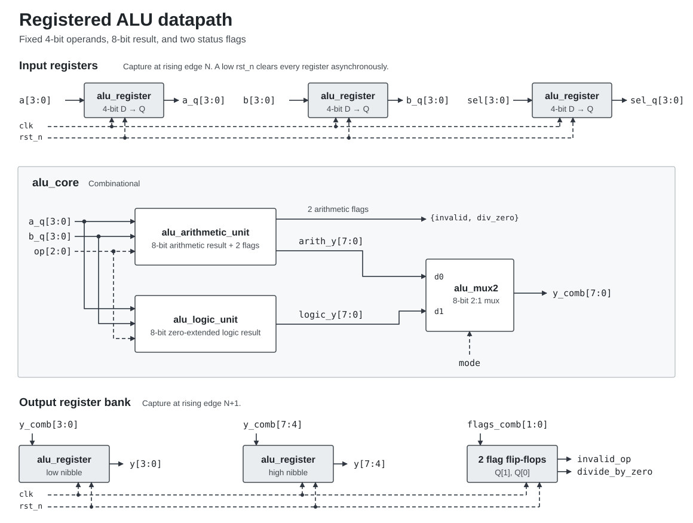
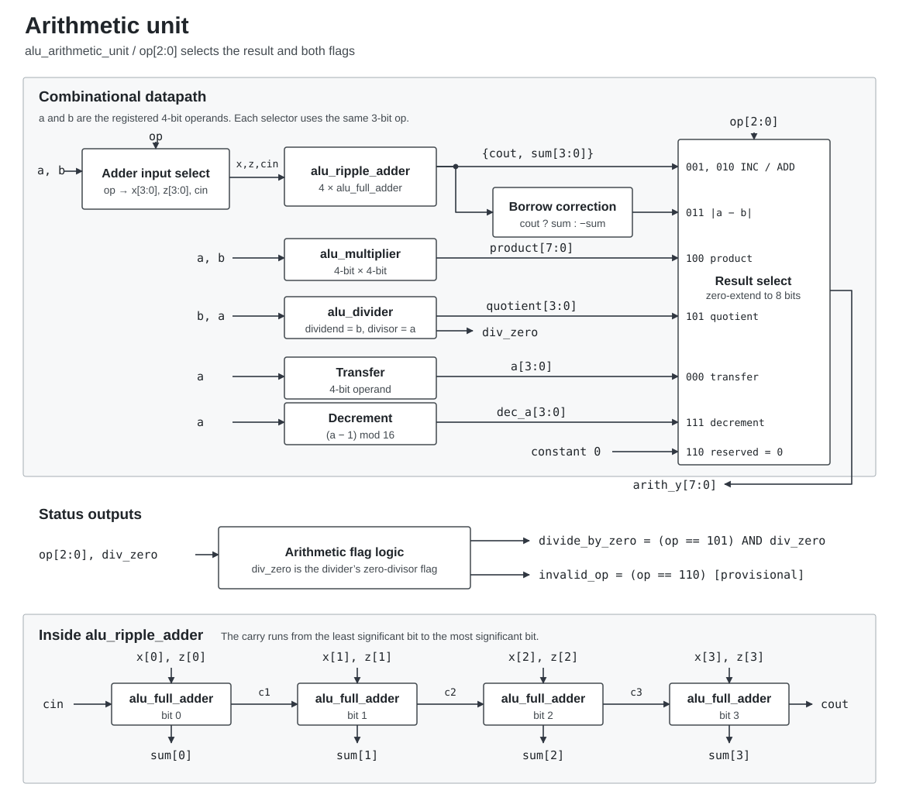
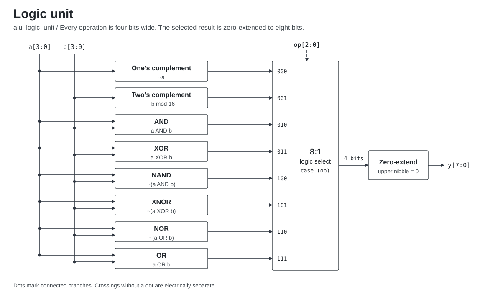

# ECE311s 4-bit ALU

Vivado workspace for the Verilog phase of the Digital Circuits project. The module definitions below specify the ports and behavior for the RTL and testbenches.

## Repository layout

| Path | What belongs there |
|---|---|
| [rtl/](rtl/) | Synthesizable Verilog, organized by module or function. |
| [tb/](tb/) | Testbenches and independent reference model. |
| [docs/](docs/) | Design notes, truth tables, diagrams, and selected verification evidence. |
| [scripts/create_project.tcl](scripts/create_project.tcl) | Creates the local Vivado project and adds source files already present. |

Vivado generates its project under `build/alu/`. Git ignores `build/`, simulator logs, and waveform databases. Commit the source files and team documentation so a fresh clone can recreate the Vivado project.

## Set up Vivado

Run the following from the repository root in a shell with Vivado on `PATH`.

~~~sh
vivado -mode batch -source scripts/create_project.tcl
~~~

You can also run `source scripts/create_project.tcl` from Vivado's Tcl Console with the repository root as the working directory. The script uses `xc7a35tcpg236-1` as the default project part. Set the environment variable `ALU_PART` before creation if you need a different device. Behavioral simulation does not require board pin constraints.

1. Open `build/alu/alu.xpr` after creating it. Reopen that file for later sessions.
2. As new files arrive, add `rtl/*.v` as **Design Sources** and `tb/*.v` as **Simulation Sources**. Keep the source files in the repository and add them by reference. Add any assigned XDC as a **Constraints** source.
3. Once the modules exist, set `alu_registered` as the design top. Set the bench you want to run as the simulation top in `sim_1`, then select **Run Simulation → Run Behavioral Simulation**. Use **Run All** for benches that terminate with `$finish`.

[AMD guide to adding simulation source files](https://docs.amd.com/r/2023.1-English/ug895-vivado-system-level-design-entry/Adding-and-Creating-Simulation-Source-Files)

## Circuit block diagram

<!-- Use a combinational `case (op)` inside each unit to select its result. The final `alu_mux2` uses `sel[3]` to choose between arithmetic and logic. In the later Cadence schematic, each unit's 8-to-1 selector can use a tree of 2-to-1 mux cells driven by the same three select bits. -->

## RTL module definitions

### Arithmetic primitives

| Module | Inputs | Outputs | Contract |
|---|---|---|---|
| `alu_full_adder` | `a`, `b`, `cin` | `sum`, `cout` | One-bit sum and carry out. |
| `alu_ripple_adder` | `a[3:0]`, `b[3:0]`, `cin` | `sum[3:0]`, `cout` | Add both operands and carry-in. Export the fifth bit as `cout`. |

#### `alu_full_adder`

Adds the two operand bits and the carry from the previous bit. `sum` is the low bit of the total and `cout` is the high bit.

#### `alu_ripple_adder`

Connect four full adders from bit 0 to bit 3. The external `cin` feeds bit 0, and each stage's `cout` feeds the next stage. The last carry and the four sum bits form the complete five-bit result `{cout, sum}`.

### Multiplier and arithmetic unit

| Module | Inputs | Outputs | Contract |
|---|---|---|---|
| `alu_multiplier` | `a[3:0]`, `b[3:0]` | `product[7:0]` | Full unsigned product. The largest product is 15 × 15 = 225. |
| `alu_arithmetic_unit` | `a[3:0]`, `b[3:0]`, `op[2:0]` | `y[7:0]`, `divide_by_zero`, `invalid_op` | Select the result and its flags by `op`. Share one four-bit ripple-adder instance across increment, addition, and absolute difference. Connect the divider's `dividend` to `b` and `divisor` to `a`. |

#### `alu_multiplier`

Takes two unsigned four-bit values and produces their full eight-bit product. For a shift-and-add design, each bit of `b` determines whether a shifted copy of `a` contributes to the product.

#### `alu_arithmetic_unit`

| `op` | Operation | How to form `y[7:0]` |
|---|---|---|
| `000` | Transfer `a` | Copy `a` to the low four bits and clear the upper four bits. |
| `001` | Increment `b` | Add one to `b` with the shared adder. Zero-extend the five-bit `{cout, sum}`. |
| `010` | Add `a + b` | Use the shared adder with carry-in zero. Zero-extend the five-bit `{cout, sum}`. |
| `011` | Absolute difference | Use the shared adder to subtract `b` from `a`, apply the borrow correction below, and zero-extend the four-bit magnitude. |
| `100` | Multiply `a × b` | Forward all eight bits of `alu_multiplier.product`. |
| `101` | Divide `b / a` | Zero-extend the four-bit quotient from `alu_divider`. The brief assumes `a` is nonzero and divides `b` exactly. For the project fallback on `a = 0`, return zero and set `divide_by_zero`. |
| `110` | Reserved (provisional) | Return zero and set `invalid_op`. |
| `111` | Decrement `a` | Compute `a - 1` modulo 16 and zero-extend the resulting four bits. |

Use `op` to drive the two four-bit inputs and the carry-in of the shared adder. Interpret the adder outputs according to the selected operation.

| `op` | Operation | First input | Second input | `cin` | Result before zero extension |
|---|---|---|---|---|---|
| `001` | Increment | `b` | `4'b0000` | `1` | `{cout, sum}` |
| `010` | Addition | `a` | `b` | `0` | `{cout, sum}` |
| `011` | Absolute difference | `a` | Four-bit `~b` | `1` | `sum` when `cout = 1`, or its four-bit two's complement when `cout = 0` |

For absolute difference, the adder computes `a + ~b + 1`. A carry-out of 1 means `a >= b`, so there was no borrow and `sum` is already the magnitude. A carry-out of 0 means `a < b` and the wrapped sum needs to be negated.

The correction can use four-bit logic. Leave bit 0 unchanged. For each higher bit, flip it only when `cout = 0` and at least one lower bit of `sum` is 1. This combines the conditional negation and result selection in a small OR, AND, and XOR network.

### Unsigned divider

| Module | Inputs | Outputs | Contract |
|---|---|---|---|
| `alu_divider` | `dividend[3:0]`, `divisor[3:0]` | `quotient[3:0]`, `divide_by_zero` | Combinational unsigned division for exact inputs. The project's zero-divisor fallback gives quotient zero and flag 1. |

#### `alu_divider`

The dividend is the value being divided and the divisor is the value it is divided by. The arithmetic unit connects `dividend = b` and `divisor = a` to compute `b/a`. For `b = 12` and `a = 3`, the outputs are `quotient = 4` and `divide_by_zero = 0`. The course assumes `a` is nonzero and divides `b` exactly. For the project's zero-divisor fallback, the outputs are `quotient = 0` and `divide_by_zero = 1`.

### Logic, selection, and registered top

| Module | Inputs | Outputs | Contract |
|---|---|---|---|
| `alu_logic_unit` | `a[3:0]`, `b[3:0]`, `op[2:0]` | `y[7:0]` | Select the four-bit logic result and zero-extend it to eight bits. |
| `alu_mux2` | `d0[7:0]`, `d1[7:0]`, `sel` | `y[7:0]` | Select `d0` for 0 and `d1` for 1. (Final output stage) |
| `alu_register` | `clk`, `rst_n`, `d[3:0]` | `q[3:0]` | Four-bit input register. Capture on the rising edge and clear asynchronously when `rst_n` is low. (Used for input and output flip-flops) |
| `alu_core` | `a[3:0]`, `b[3:0]`, `sel[3:0]` | `y[7:0]`, `divide_by_zero`, `invalid_op` | Send `sel[2:0]` to both units and use `sel[3]` for the final 2-to-1 mux. Clear both flags for logic operations. |
| `alu_registered` | `clk`, `rst_n`, `a[3:0]`, `b[3:0]`, `sel[3:0]` | `y[7:0]`, `divide_by_zero`, `invalid_op` | Capture the operands and select with three four-bit input registers. Capture the eight-bit result and two flags in a fixed ten-bit output register bank on the next rising edge. |

#### `alu_logic_unit`

This combinational unit uses `case (op)` to choose a four-bit result. Put that result in `y[3:0]` and clear `y[7:4]` for every operation.

| `op` | Operation | How to form `y[3:0]` |
|---|---|---|
| `000` | One's complement of `a` | Invert each bit of `a`. |
| `001` | Two's complement of `b` | Compute `-b` modulo 16. |
| `010` | AND | Compute `a & b`. |
| `011` | XOR | Compute `a ^ b`. |
| `100` | NAND | Compute `~(a & b)`. |
| `101` | XNOR | Compute `~(a ^ b)`. |
| `110` | NOR | Invert the bitwise OR of `a` and `b`. |
| `111` | OR | Compute the bitwise OR of `a` and `b`. |

#### `alu_mux2`

Forwards an entire eight-bit bus. In `alu_core`, connect the arithmetic result to `d0`, the logic result to `d1`, and the core's `sel[3]` to the mux's single-bit `sel`. If `d0 = 8'h1E` and `d1 = 8'h0C`, the output is `8'h1E` for `sel = 0` and `8'h0C` for `sel = 1`.

#### `alu_register`

Stores four bits. With `rst_n` high, a rising clock edge copies `d` to `q`. Changes to `d` between rising edges leave `q` at its stored value. For example, capture `4'h9` at a rising edge, then change `d` to `4'h2`. The output holds `4'h9` until the next rising edge. Driving `rst_n` low clears `q` without waiting for a clock edge. The eight result bits can use two such registers as part of the output bank.

#### `alu_core`

Connects both operation units and the final mux. Both units receive the same operands and `sel[2:0]`. The mux selects the result with `sel[3]`, and the core forwards arithmetic flags only in arithmetic mode.

#### `alu_registered`

Wraps `alu_core` with input and output registers. On rising edge **N**, the input registers capture `a`, `b`, and `sel` together. The core computes from those stored values during the cycle. At **N+1**, the output register bank captures the result and both flags while the input registers accept the next transaction.

## Verification

Use an independent expected-result model in `tb/`. Record the simulator, test top, coverage totals, and pass/fail result in `docs/verification.md`.

| Planned file | What to verify |
|---|---|
| `tb/tb_primitives.v` | Full adder, ripple adder with both carry-in values, both paths of the 2-to-1 mux, and register capture, hold, and reset. |
| `tb/tb_arithmetic_blocks.v` | Full product over all 256 operand pairs. Check exact division and the zero-divisor fallback. |
| `tb/tb_units.v` | All eight binary opcode selections per unit over all 256 operand pairs. Check increment and addition carry, both borrow paths and equality for absolute difference, and the arithmetic status flags. |
| `tb/tb_alu_core.v` | Sweep all 4,096 combinations of four-bit `a`, `b`, and `sel` and compare the specified results and flags. |
| `tb/tb_alu_registered.v` | Stream the same combinations. Check the next-edge result, reset with a transaction pending, and stable outputs between edges. |
| `tb/tb_waveforms.v` | Produce a short labeled trace covering every opcode and representative edge cases. |
| `tb/reference_model.vh` | Shared test-only expected-result and flag functions. The project script adds `tb/` to the simulation include path. |

For division, compare quotient values for exact inputs (`a != 0` and `b % a == 0`) and test the zero-divisor fallback. For the registered bench, drive inputs on falling edges and compare after the rising-edge register update against the transaction captured one edge earlier. Report the input transaction, cycle, expected result, and observed result for any mismatch, including unknown outputs.

## Opcode reference

The low three bits select a row. The high bit selects the arithmetic or logic column. Complements, bitwise logic, and decrement operate on four bits before zero extension. Both flags default to zero.

| `sel[2:0]` | Arithmetic when `sel[3]=0` | Logic when `sel[3]=1` |
|---|---|---|
| `000` | Transfer `a` | One's complement of `a` |
| `001` | Increment `b` with carry | Two's complement of `b` |
| `010` | Add `a+b` with carry | AND |
| `011` | Larger operand minus smaller operand | XOR |
| `100` | Full product `a*b` | NAND |
| `101` | Exact unsigned quotient `b/a` | XNOR |
| `110` | Provisional reserved code. Return zero and set `invalid_op`. | NOR |
| `111` | Decrement `a` modulo 16 | OR |
